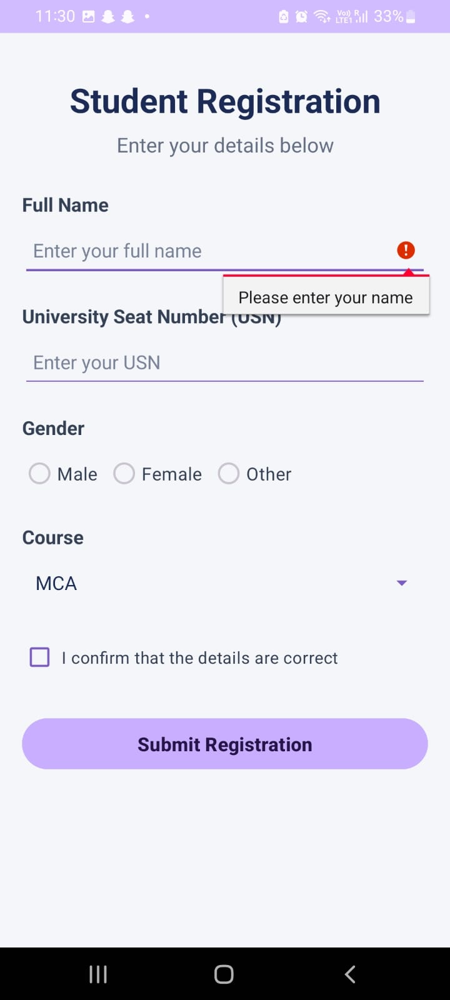
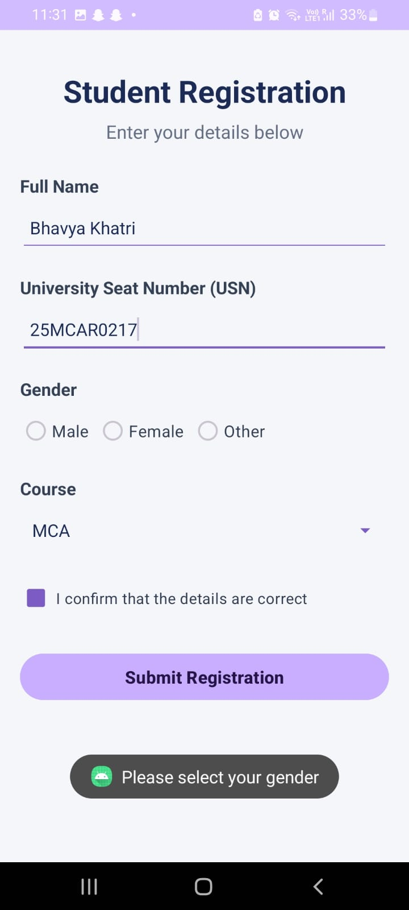
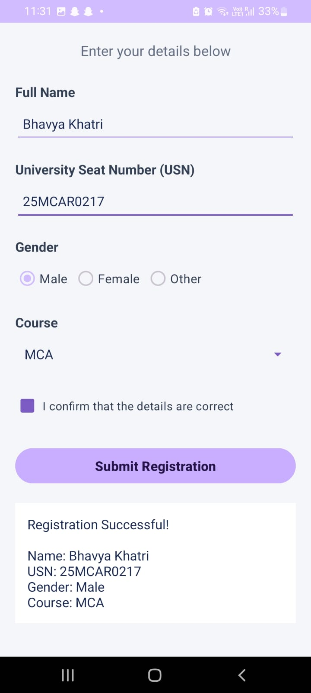
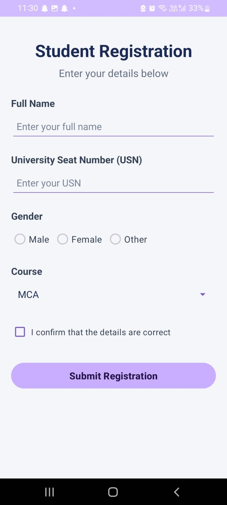

# Experiment 06: Android Application Using Basic Views

## Aim
To develop an Android application using basic Android Views to collect and validate student registration details.

## Description
The Student Registration application allows users to enter their full name and University Seat Number (USN), select their gender and course, confirm their details, and submit the form.

The application validates the entered information and displays the registration details when all required fields are completed correctly.

## Concepts and Technologies Used
- **Android Studio:** IDE used to develop and run the application.
- **Kotlin:** Programming language used for application logic.
- **XML Layouts:** Used to design the user interface.
- **TextView:** Displays headings, labels, and registration results.
- **EditText:** Accepts the student's name and USN.
- **RadioGroup and RadioButton:** Allow the user to select one gender option.
- **Spinner:** Displays the available courses.
- **ArrayAdapter:** Supplies course data to the Spinner.
- **CheckBox:** Confirms that the entered details are correct.
- **Button:** Submits the registration form.
- **Toast:** Displays validation and submission messages.
- **ScrollView and LinearLayout:** Organize the form and support scrolling.

## Application Scenario
Student registration requires collecting basic student information and ensuring that mandatory details are provided. This application demonstrates how Android Views can be used to create a registration form with input validation and confirmation.

## Features
1. Accepts the student's full name.
2. Accepts the University Seat Number (USN).
3. Provides Male, Female, and Other gender options.
4. Provides the following course options:
   - MCA
   - MBA
   - BCA
   - BBA
   - B.Com
   - B.Sc
5. Requires confirmation through a checkbox.
6. Validates missing information.
7. Displays the entered details after successful registration.

## Project Structure

```text
Experiment06/
├── app/
│   └── src/
│       └── main/
│           ├── java/
│           │   └── com/bhavya/experiment06/
│           │       └── MainActivity.kt
│           ├── res/
│           │   └── layout/
│           │       ├── activity_main.xml
│           │       ├── spinner_item.xml
│           │       └── spinner_dropdown_item.xml
│           └── AndroidManifest.xml
├── gradle/
│   └── libs.versions.toml
├── screenshots/
│   ├── app_output.png
│   ├── test1_empty_form.png
│   ├── test2_missing_gender.png
│   └── test3_successful_registration.png
├── build.gradle.kts
├── settings.gradle.kts
└── README.md
```

## Testing and Results

### Test Case 1: Empty Form

**Action:** Click the Submit Registration button without entering any details.

**Expected Result:** The application displays a validation error asking the user to enter their name.

**Observed Result:** The name validation error is displayed.

**Screenshot:**




### Test Case 2: Missing Gender

**Action:** Enter the name and USN, select the confirmation checkbox, leave gender unselected, and click Submit Registration.

**Expected Result:** The application displays a warning asking the user to select their gender.

**Observed Result:** The warning "Please select your gender" is displayed.

**Screenshot:**




### Test Case 3: Successful Registration

**Action:** Enter the name and USN, select a gender and course, tick the confirmation checkbox, and click Submit Registration.

**Expected Result:** The application displays a success message along with the entered name, USN, gender, and course.

**Observed Result:** Registration is successful, and the entered details are displayed.

**Screenshot:**




## Application Output

The following screenshot shows the initial Student Registration form.




## Conclusion

The Android application was developed successfully using basic Android Views. It collects student details, validates required inputs, and displays the registration result after successful submission.