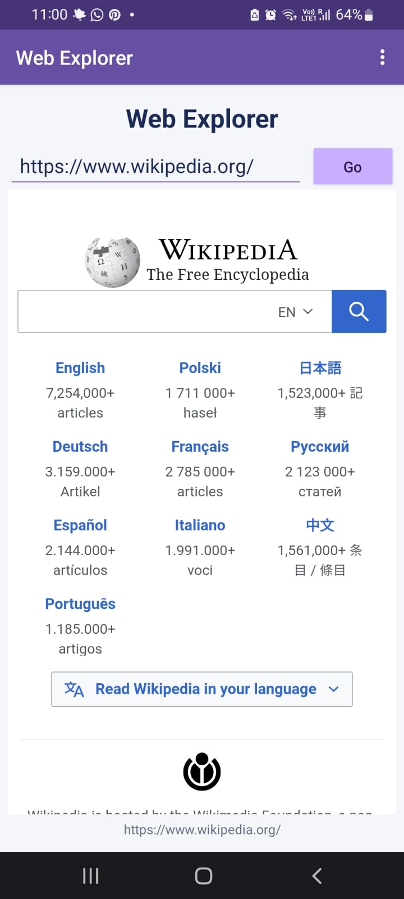
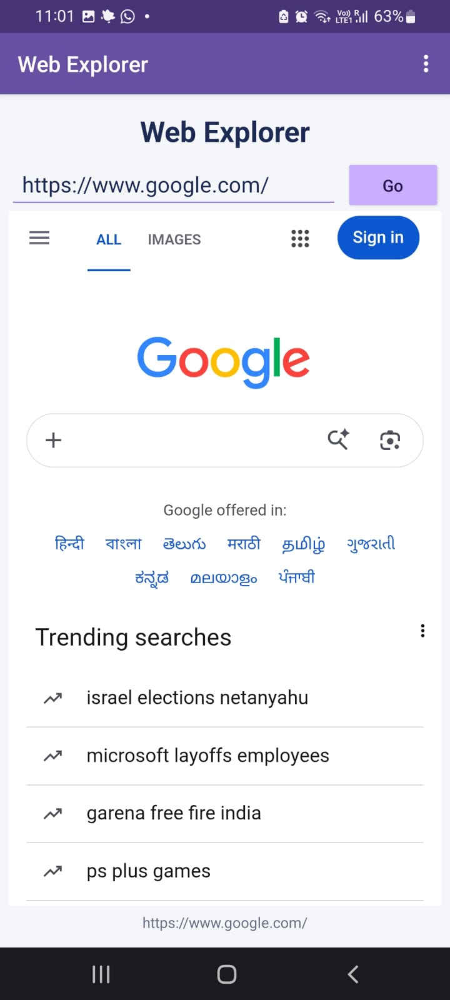
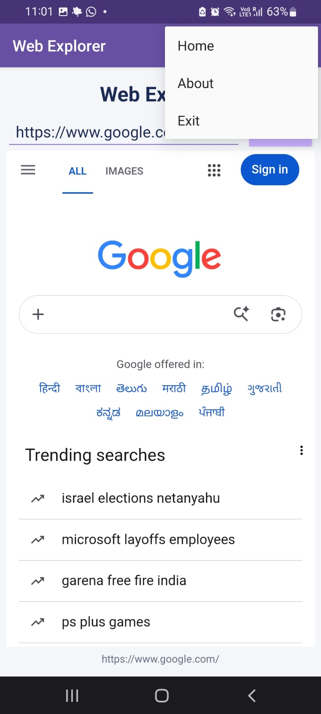
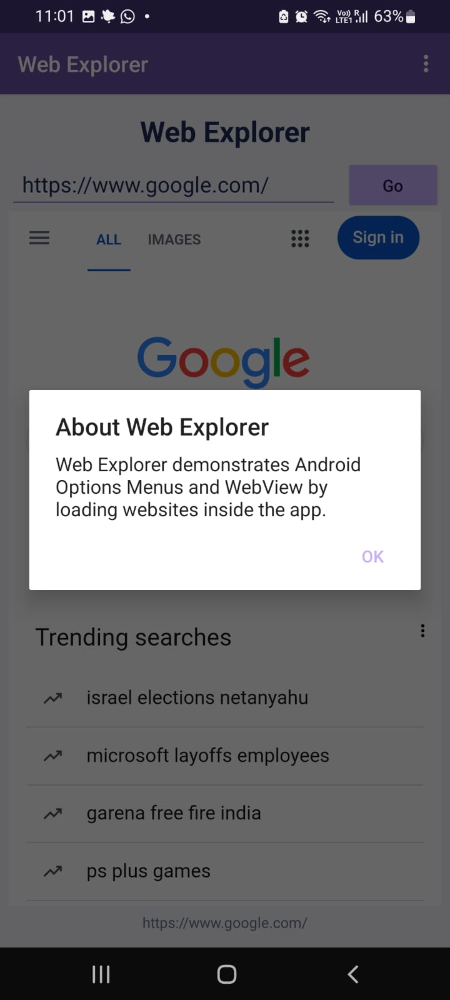

# Experiment 08: Implement Menus and WebView in an Android Application

## 1. Aim

To develop an Android application that demonstrates the implementation of an Options Menu and a WebView using Kotlin and XML layouts.

## 2. Description

Web Explorer is a simple Android application that allows users to browse websites inside the application. Users can enter a website URL and load it using the Go button. The application also provides an Options Menu containing Home, About, and Exit actions.

The Home option loads Wikipedia, the About option displays information about the application, and the Exit option closes the activity.

## 3. Concepts and Technologies Used

- **Android Studio:** Used to develop, build, and test the application.
- **Kotlin:** Used to implement the application logic.
- **XML Layouts:** Used to design the user interface.
- **Options Menu:** Provides Home, About, and Exit actions.
- **WebView:** Displays web pages inside the application.
- **EditText:** Accepts a website URL from the user.
- **Button:** Loads the entered website when the user taps Go.
- **WebViewClient:** Handles web navigation inside the application.
- **WebChromeClient:** Tracks page-loading progress.
- **AlertDialog:** Displays information about the application.
- **Internet Permission:** Allows the application to access websites.

## 4. Application Scenario

A user wants to access websites through a simple Android application without switching to an external browser. The application provides a URL field, a Go button, and an embedded WebView for displaying websites. An Options Menu provides convenient navigation and application information.

## 5. Features

1. Loads Wikipedia when the application starts.
2. Allows users to enter and load website URLs.
3. Displays web pages inside the application using WebView.
4. Provides a Home menu option to return to Wikipedia.
5. Displays an About dialog describing the application.
6. Provides an Exit option to close the activity.
7. Displays loading progress while web pages load.
8. Supports navigation to previously visited pages using the device's Back button.

## 6. Project Folder Structure

```text
Experiment08/
├── app/
│   └── src/
│       └── main/
│           ├── java/
│           │   └── com/bhavya/experiment08/
│           │       └── MainActivity.kt
│           ├── res/
│           │   ├── layout/
│           │   │   └── activity_main.xml
│           │   ├── menu/
│           │   │   └── menu_main.xml
│           │   └── values/
│           │       └── themes.xml
│           └── AndroidManifest.xml
├── gradle/
├── screenshots/
│   ├── test1_webview_home.png
│   ├── test2_url_navigation.png
│   ├── test3_options_menu.png
│   └── test4_about_dialog.png
├── build.gradle.kts
├── settings.gradle.kts
└── README.md
```

## 7. Test Cases

### Test Case 1: Initial WebView Display

**Action:** Launch the application.

**Expected Result:** The Web Explorer interface appears, and Wikipedia loads inside the WebView.

**Observed Result:** The application opens successfully and displays Wikipedia inside the WebView.

**Screenshot:**



### Test Case 2: URL Navigation

**Action:** Enter `https://www.google.com/` in the URL field and tap the Go button.

**Expected Result:** Google loads inside the application's WebView.

**Observed Result:** The entered website loads successfully inside the WebView.

**Screenshot:**



### Test Case 3: Options Menu

**Action:** Open the Options Menu using the three-dot icon and verify that Home, About, and Exit are displayed.

**Expected Result:** The Options Menu appears with all three menu items.

**Observed Result:** The Options Menu displays Home, About, and Exit.

**Screenshot:**



### Additional Evidence: About Dialog

**Action:** Open the Options Menu and select About.

**Expected Result:** A dialog appears with information about the Web Explorer application.

**Observed Result:** The About dialog appears successfully.

**Screenshot:**



## 8. Conclusion

The Web Explorer Android application was implemented successfully using Kotlin, XML layouts, an Options Menu, and WebView. The application loads websites internally, supports URL navigation, displays application information through an About dialog, and provides Home and Exit menu actions.