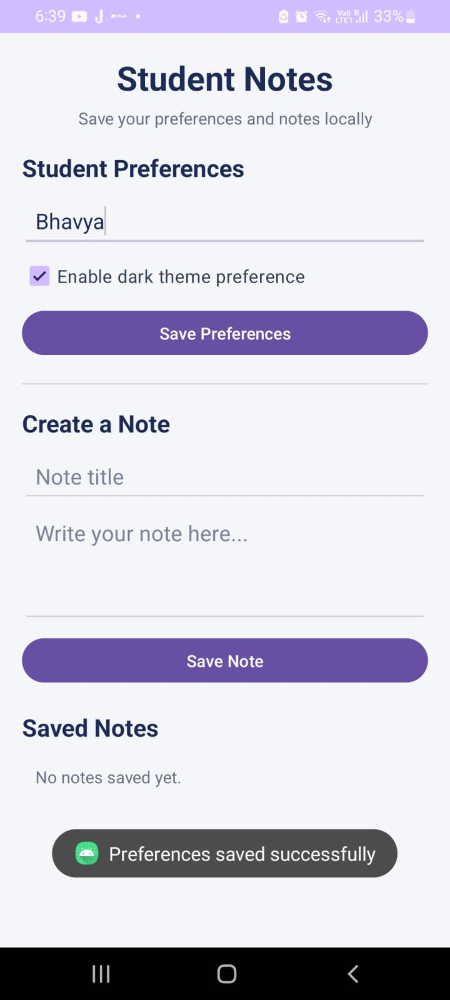
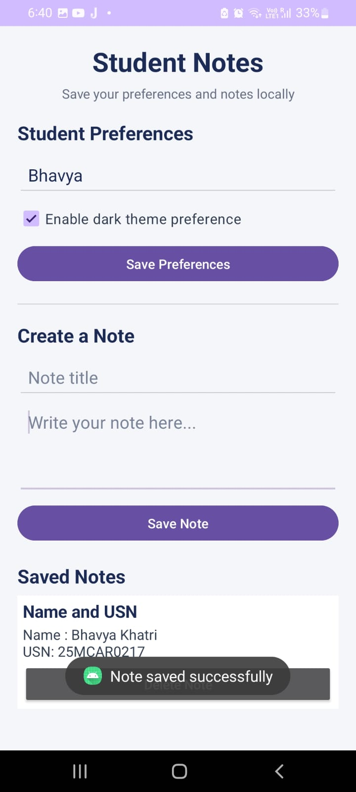
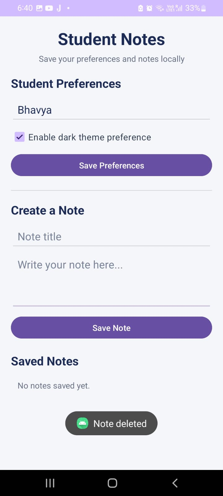

# Experiment 09: Demonstrate Data Persistence Using SharedPreferences and SQLite

## 1. Aim

To develop an Android application that demonstrates data persistence using SharedPreferences and SQLite.

## 2. Description

Student Notes is an Android application developed using Kotlin and XML layouts. It demonstrates how an application can store data locally so that the information remains available after the application is closed and reopened.

The application uses SharedPreferences to save simple student preferences, including the student's name and a theme preference. SQLite is used to store structured notes containing a title and content. Users can save notes, view saved notes, and delete notes.

## 3. Concepts and Technologies Used

- **Android Studio:** Used to develop, build, and test the application.
- **Kotlin:** Used to implement application functionality.
- **XML Layouts:** Used to design the user interface.
- **SharedPreferences:** Stores small amounts of data as key-value pairs.
- **SQLite:** Stores structured data in a local relational database.
- **SQLiteOpenHelper:** Creates and manages the SQLite database.
- **ContentValues:** Supplies values when inserting records into SQLite.
- **EditText:** Accepts the student's name, note title, and note content.
- **CheckBox:** Allows the user to select a theme preference.
- **Button:** Performs actions such as saving preferences, saving notes, and deleting notes.
- **LinearLayout and ScrollView:** Arrange the interface elements and allow scrolling.
- **Toast:** Displays brief messages indicating whether an operation succeeded.

## 4. Application Scenario

Students may need to save personal preferences and short notes while using a mobile application. Student Notes demonstrates how this information can be stored locally without requiring an internet connection or an external server.

The application uses two persistence mechanisms:

1. SharedPreferences stores the student's name and selected theme preference.
2. SQLite stores notes with their titles and contents, allowing users to retrieve or delete them later.

This scenario demonstrates the difference between storing simple settings and managing structured records in a database.

## 5. Features

1. Enter and save the student's name.
2. Select and save the theme preference.
3. Restore saved preferences when the application is reopened.
4. Enter a note title and its content.
5. Save notes in a local SQLite database.
6. Display saved notes on the screen.
7. Delete individual notes.
8. Retain saved notes after closing and reopening the application.
9. Display feedback messages for successful operations.

## 6. Project Folder Structure

```text
Experiment09/
├── app/
│   └── src/
│       └── main/
│           ├── java/
│           │   └── com/bhavya/experiment09/
│           │       ├── MainActivity.kt
│           │       └── NotesDatabaseHelper.kt
│           ├── res/
│           │   ├── layout/
│           │   │   └── activity_main.xml
│           │   └── values/
│           └── AndroidManifest.xml
├── gradle/
│   └── libs.versions.toml
├── screenshots/
│   ├── test1_shared_preferences.jpeg
│   ├── test2_sqlite_persistence.jpeg
│   └── test3_delete_note.jpeg
├── build.gradle.kts
├── settings.gradle.kts
└── README.md
```

Note: Android Studio may generate additional files and folders. The structure above highlights the main files relevant to this experiment.

## 7. Test Cases

### Test Case 1: SharedPreferences Persistence

**Action:**
1. Enter the student's name.
2. Select the theme-preference checkbox.
3. Tap Save Preferences.
4. Close and reopen the application to verify that the saved values are restored.

**Expected Result:** The student's name and checkbox preference should remain saved after restarting the application.

**Observed Result:** The preferences were saved successfully and remained available after reopening the application.

**Screenshot:**



### Test Case 2: SQLite Note Storage and Retrieval

**Action:**
1. Enter a note title and content.
2. Include the student's name and USN in the note to demonstrate the required student details.
3. Tap Save Note.
4. Verify that the note appears under Saved Notes.
5. Reopen the application and verify that the note remains available.

**Expected Result:** The note should be stored in SQLite and remain available after restarting the application.

**Observed Result:** The note was saved successfully and displayed with its title and content. The screenshot also shows the student's name and USN.

**Screenshot:**



### Test Case 3: Delete a Saved Note

**Action:**
1. Open the application with a previously saved note.
2. Tap Delete Note for that entry.
3. Verify that the note disappears from the saved-notes list.

**Expected Result:** The selected note should be deleted from the SQLite database and should no longer appear in the list.

**Observed Result:** The note was deleted successfully, and the application displayed the updated list.

**Screenshot:**



## 8. Conclusion

The Student Notes Android application was implemented successfully using SharedPreferences and SQLite. SharedPreferences was used to store simple student preferences, while SQLite was used to create, retrieve, and delete notes. The application demonstrates local data persistence and verifies that saved information remains available across application restarts.
