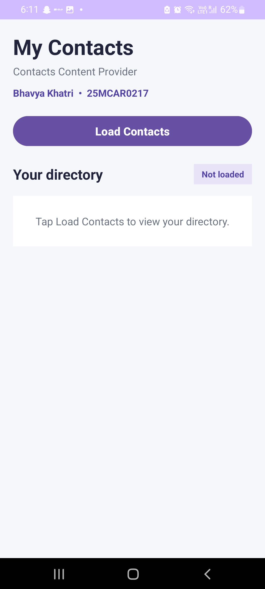
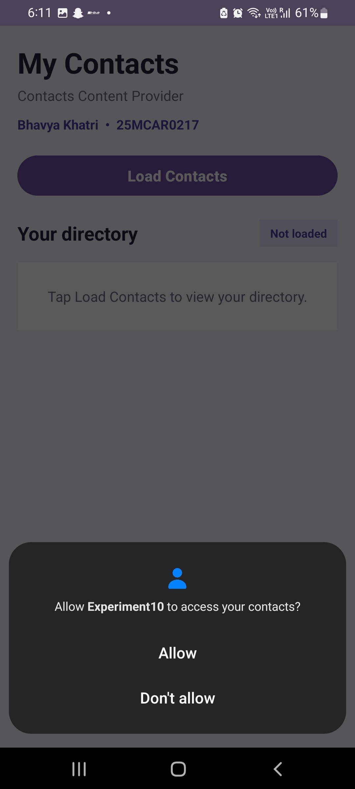
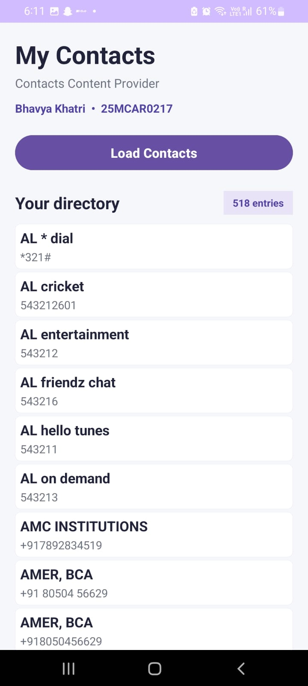

# Experiment 10: Data Sharing Using Contacts Content Provider

## Overview

This experiment demonstrates how an Android application accesses contact information through the **Contacts Content Provider**. The application requests the user's permission to read contacts and displays the available contact names and phone numbers in a scrollable directory.

## Objectives

- Understand the role of Android Content Providers.
- Request runtime permission to access device contacts.
- Retrieve contact names and phone numbers using `ContactsContract`.
- Display retrieved information in a structured user interface.

## Technologies Used

- **Language:** Kotlin
- **UI:** XML
- **IDE:** Android Studio
- **API:** Android Contacts Content Provider
- **Data access:** `ContentResolver`
- **Permission:** `READ_CONTACTS`

## How It Works

1. The application displays the My Contacts screen with a **Load Contacts** button.
2. When the button is tapped, the application checks whether contacts permission has already been granted.
3. If permission has not been granted, Android displays a permission request.
4. Once permission is granted, the application queries the Contacts Content Provider using `ContentResolver` and `ContactsContract.CommonDataKinds.Phone`.
5. Contact names and phone numbers are displayed as individual cards, and the total number of retrieved phone-number entries is shown.

If permission is denied, the application displays a message explaining that access is required.

## Implementation Details

| File | Responsibility |
|---|---|
| `MainActivity.kt` | Handles permission requests, queries contacts, and creates contact cards |
| `activity_main.xml` | Defines the screen layout, header, button, directory count, and contact container |
| `AndroidManifest.xml` | Declares the `READ_CONTACTS` permission |
| `build.gradle.kts` | Configures the Android application module and dependencies |
| `libs.versions.toml` | Manages dependency versions |

## Project Structure

```text
Experiment10/
├── AndroidProject/
│   └── Experiment10/
│       ├── app/
│       │   ├── src/main/
│       │   │   ├── java/com/bhavya/experiment10/
│       │   │   │   └── MainActivity.kt
│       │   │   ├── res/layout/
│       │   │   │   └── activity_main.xml
│       │   │   └── AndroidManifest.xml
│       │   └── build.gradle.kts
│       ├── gradle/
│       │   └── libs.versions.toml
│       ├── build.gradle.kts
│       └── settings.gradle.kts
├── Screenshots/
│   ├── test_case_1_initial_screen.png
│   ├── test_case_2_permission_request.png
│   └── test_case_3_contacts_loaded.png
└── README.md
```

*The structure above shows the intended submission layout. Include the actual Gradle wrapper files and other project configuration files when copying your Android Studio project. The README and screenshots should remain inside `Experiment10/`.*

## Test Cases and Screenshots

### Test Case 1: Initial Application Screen

**Purpose:** Verify that the application launches and displays the expected interface.

**Procedure:** Launch Experiment10 without loading contacts.

**Expected result:** The screen displays the My Contacts heading, student identification, Load Contacts button, directory heading, and initial empty-state message.

**Screenshot:** `Screenshots/test_case_1_initial_screen.jpeg`



### Test Case 2: Contacts Permission Request

**Purpose:** Verify that the application requests permission before accessing contacts.

**Procedure:** Tap Load Contacts when contacts permission has not yet been granted.

**Expected result:** Android displays a permission dialog asking whether Experiment10 can access contacts.

**Screenshot:** `Screenshots/test_case_2_permission_request.jpeg`



### Test Case 3: Contacts Successfully Loaded

**Purpose:** Verify that the application retrieves and displays contact information after permission is granted.

**Procedure:** Grant contacts permission and load the contacts directory.

**Expected result:** Contact names and phone numbers appear in individual cards, and the directory count updates to reflect the retrieved phone-number entries.

**Screenshot:** `Screenshots/test_case_3_contacts_loaded.jpeg`



## Output

The application successfully displays a scrollable directory of contact names and phone numbers retrieved from the device. The interface also displays the student's name and USN.

**Student:** Bhavya Khatri  
**USN:** 25MCAR0217

## Result

The experiment demonstrates Android contact data access through the Contacts Content Provider using Kotlin and XML. Runtime permission handling and the display of retrieved contact information are implemented in the application.