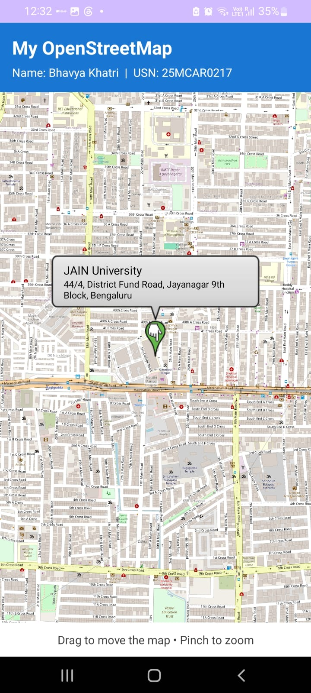
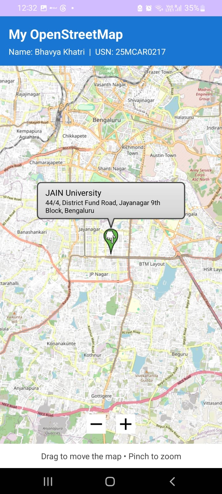
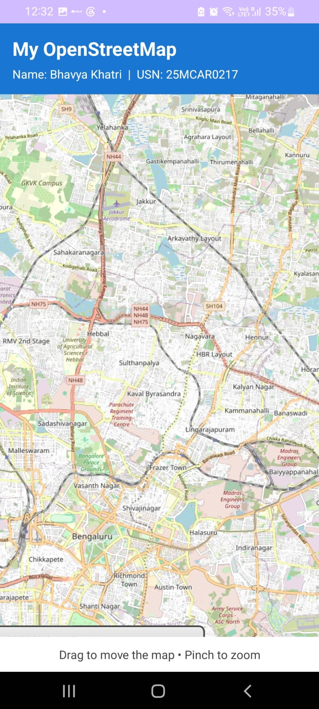

# Experiment 11 – Displaying Maps Using OpenStreetMap

## 1. Aim

To develop an Android application that displays an interactive map using OpenStreetMap and allows users to view a specific geographical location with a marker.

## 2. Description

This experiment demonstrates how maps can be integrated into an Android application using the OpenStreetMap platform and the osmdroid library.

The application displays an interactive map centered on JAIN (Deemed-to-be University), Jayanagar, Bengaluru. A location marker identifies the university, and an information window displays its name and address.

Users can interact with the map by zooming in, zooming out, and moving across different geographical areas.

## 3. Concepts and Technologies Used

- **Android Studio:** Development environment used to build the Android application.
- **Kotlin:** Programming language used for application logic.
- **XML:** Used to design the application interface.
- **OpenStreetMap:** Open-source mapping platform providing geographical map data.
- **osmdroid:** Android library used to display and interact with OpenStreetMap.
- **GeoPoint:** Represents a geographical location using latitude and longitude.
- **Marker:** Identifies a specific location on the map.
- **Internet Permission:** Allows the application to download map tiles.

## 4. Application Scenario

Consider a student who wants to locate JAIN University in Jayanagar, Bengaluru.

Instead of manually searching through a map, the student can open the application and immediately view the university's location.

The application displays a marker at the university and provides its address through an information window. The student can zoom in to examine nearby streets or zoom out to view the surrounding area.

This demonstrates how map integration can be used in applications such as campus navigation, location identification, travel assistance, and geographical information systems.

## 5. Features

1. Displays an interactive OpenStreetMap map.
2. Opens the map centered on JAIN University, Jayanagar, Bengaluru.
3. Displays a marker identifying the university.
4. Shows the university name and address in an information window.
5. Supports map zooming and panning.
6. Displays student name and USN on the application screen.

## 6. Project Folder Structure

```text
Experiment11/
│
├── app/
│   └── src/
│       └── main/
│           ├── java/
│           │   └── com/
│           │       └── bhavya/
│           │           └── experiment11/
│           │               └── MainActivity.kt
│           │
│           ├── res/
│           │   ├── layout/
│           │   │   └── activity_main.xml
│           │   ├── drawable/
│           │   ├── mipmap/
│           │   └── values/
│           │
│           └── AndroidManifest.xml
│
├── gradle/
│   └── libs.versions.toml
│
├── screenshots/
│   ├── test1_map_display.png
│   ├── test2_map_zoom.png
│   └── test3_map_navigation.png
│
├── build.gradle.kts
├── settings.gradle.kts
└── README.md
```

## 7. Test Cases

### Test Case 1: Display Map and Location Marker

**Objective:** To verify that the application successfully loads the OpenStreetMap and displays the university's location.

**Procedure:**
1. Launch the application.
2. Wait for the map tiles to load.
3. Verify that the map is centered on JAIN University.
4. Check that the location marker and information window are visible.

**Expected Result:** The map loads successfully and displays the JAIN University marker with its address. Student name and USN are also visible.

**Screenshot:**



### Test Case 2: Map Zoom Functionality

**Objective:** To verify that users can zoom in and zoom out of the displayed map.

**Procedure:**
1. Open the application.
2. Use the two-finger pinch-out gesture to zoom in.
3. Use the pinch-in gesture to zoom out.
4. Observe the changes in map detail and scale.

**Expected Result:** The map zooms in and out correctly, displaying different levels of geographical detail.

**Screenshot:**



### Test Case 3: Map Navigation Functionality

**Objective:** To verify that users can move across different geographical areas using map navigation.

**Procedure:**
1. Open the application.
2. Touch and drag the map in different directions.
3. Observe the change in the displayed geographical area.

**Expected Result:** The map moves smoothly in the selected direction and displays the surrounding geographical areas.

**Screenshot:**



## 8. Conclusion

The experiment was successfully implemented using OpenStreetMap and the osmdroid library in Android Studio.

The application displays an interactive map with a location marker identifying JAIN University, Jayanagar, Bengaluru. It also demonstrates map zooming, panning, and location information display.

Thus, the experiment demonstrates the integration of open-source mapping technology into an Android application.