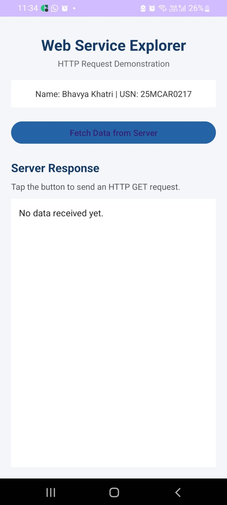
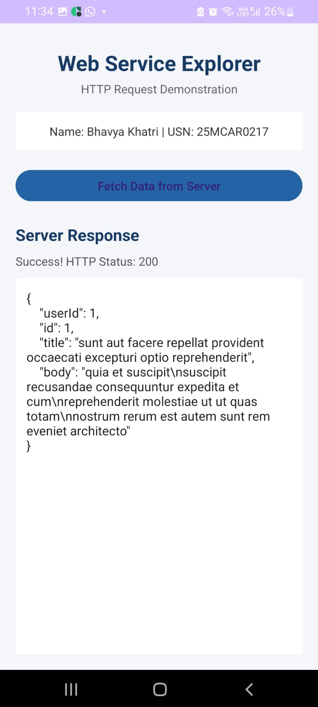
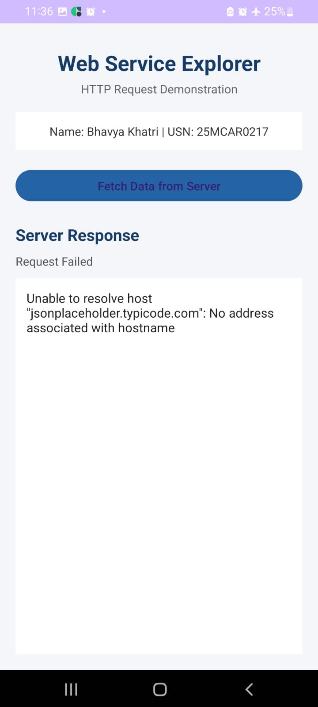

# Experiment 12 – Web Service Explorer

## Aim
To develop an Android application that consumes web services using HTTP requests and displays the data received from a server.

## Description
Web Service Explorer is an Android application developed using Kotlin. It demonstrates communication between an Android application and a web server using an HTTP GET request.

The application connects to the JSONPlaceholder REST API, retrieves data in JSON format, parses the response, and displays it on the screen. It also handles network errors and connection failures.

## Concepts and Technologies Used
- Android Studio
- Kotlin
- XML Layout
- HTTP GET Request
- REST API
- JSON Parsing
- HttpURLConnection
- Background Thread
- Internet Permission

## Application Scenario
Web services allow Android applications to communicate with remote servers and exchange data.

This application demonstrates how a mobile application sends a request to a remote server, receives a JSON response, processes the data, and displays the retrieved information to the user.

## Features
- Sends HTTP GET requests to a remote server.
- Retrieves data from the JSONPlaceholder REST API.
- Parses JSON responses using JSONObject.
- Displays the server response and HTTP status code.
- Handles network failures and connection errors.
- Displays student name and USN.

## Project Folder Structure

```text
Experiment12/
│
├── app/
│   └── src/
│       └── main/
│           ├── java/com/bhavya/experiment12/
│           │   └── MainActivity.kt
│           │
│           ├── res/
│           │   └── layout/
│           │       └── activity_main.xml
│           │
│           └── AndroidManifest.xml
│
├── screenshots/
│   ├── test1_initial_screen.jpeg
│   ├── test2_successful_http_request.jpeg
│   └── test3_network_failure.jpeg
│
└── README.md
```

## Test Cases

### Test Case 1: Initial Application Screen

**Objective:** To verify that the application launches successfully.

**Procedure:** Open the application on the Android device.

**Output:** The application displays the Web Service Explorer heading, student details, Fetch Data from Server button, and Server Response section.

**Result:** The application launched successfully and displayed the initial screen.



### Test Case 2: Successful HTTP GET Request

**Objective:** To verify successful communication between the application and the web server.

**Procedure:** Ensure internet connectivity and tap the Fetch Data from Server button.

**Output:** The application sends an HTTP GET request, receives an HTTP 200 response, parses the JSON data, and displays the userId, id, title, and body.

**Result:** The application successfully retrieved and displayed the server response.



### Test Case 3: Network Failure Handling

**Objective:** To verify the application's ability to handle network connection failures.

**Procedure:** Disable internet connectivity and tap the Fetch Data from Server button.

**Output:** The application displays a Request Failed status along with an appropriate network error message.

**Result:** The application successfully detected the network failure and displayed the corresponding error message.



## Conclusion
The application successfully demonstrates communication between an Android application and a web service using HTTP GET requests. It retrieves JSON data from a remote server, parses and displays the response, and handles network failures effectively.